# System Architecture

The **CvSU Document Generator** is engineered as a hybrid desktop application combining a rich modern frontend rendered via **PyWebView** (Edge Chromium / WebView2 on Windows) with a multi-threaded Python backend.

Related notes:
- [[CvSU Document Generator MOC]]
- [[PyWebView Bridge]]
- [[Generator Pipeline]]
- [[Orchestrator Lifecycle]]
- [[UI Architecture]]
- [[Generators Overview]]
- [[Testing Strategy]]
- [[HIG & UX Audit]]
- [[Documentation & Skills Audit]]

---

## 🏛️ High-Level Architectural Flow

```mermaid
graph LR
    subgraph Frontend ["Frontend (HTML / CSS / JS)"]
        UI["ui.html (Batch Workbench / Apple HIG)"]
        State["js/state.js"]
        StepperUI["js/stepper.js (6 Contextual Stages)"]
        StepHandlers["js/step1.js, step2.js, step3.js"]
        BridgeJS["js/bridge.js"]
    end

    subgraph IPC ["PyWebView IPC Bridge"]
        API["executable_test/api/ (ScriptAPI Mixins)"]
    end

    subgraph Backend ["Python Core Services"]
        Config["ConfigManager"]
        Parser["modules/parsers/schedule_parser.py"]
        Roster["modules/parsers/roster_parser.py"]
        Validator["modules/services/validator.py"]
        Orchestrator["modules/services/orchestrator.py"]
    end

    subgraph DynamicEngine ["Dynamic Analysis & Rendering Engine"]
        Analyzer["modules/parsers/template_analyzer.py<br/>(DeterministicTemplateAnalyzer)"]
        Grid["modules/parsers/docx_grid_table.py<br/>(DocxGridTable Normalizer)"]
        Renderer["modules/generators/dynamic_renderer.py<br/>(DynamicDocumentRenderer)"]
    end

    subgraph Engines ["Generation Engines"]
        CEIT["modules/generators/ceit_gen.py"]
        Att["modules/generators/attendance_gen.py"]
        Grade["modules/generators/grade_gen.py"]
        Custom["modules/generators/generic_doc_gen.py"]
    end

    UI --> State
    State --> StepperUI
    StepperUI --> StepHandlers
    StepHandlers --> BridgeJS
    BridgeJS <==>|"window.pywebview.api"| API

    API --> Config
    API --> Parser
    API --> Roster
    API --> Validator
    API --> Orchestrator

    Orchestrator --> DynamicEngine
    DynamicEngine --> Engines
    Orchestrator --> CEIT
    Orchestrator --> Att
    Orchestrator --> Grade
    Orchestrator --> Custom
```

---

## 🧩 Architectural Subsystems

### 1. Presentation & Transport Layer (`executable_test/`)
- **Transport Scheme (`file:///`)**: Application transport uses an explicit resolved file URI (`document_url = Path(html_template).resolve().as_uri()`), eliminating loopback port contention, WSGI queueing, and startup socket starvation.
- **Single-Page Application**: Hosted in `executable_test/ui.html` with an inline `` failsafe in `<head>` to enforce visibility state prior to external asset loading.
- **Decoupled CSS Architecture**: Separated into 7 modular stylesheets:
  - `css/tokens.css` (Apple HIG semantic color palettes, 4px base spacing scale, Segoe UI Variable typography tokens)
  - `css/base.css` (global resets, visible focus rings, WCAG scroll padding)
  - `css/layout.css` (fluid 2160px shell workspace, centered workflow ribbon)
  - `css/components.css` (stepper chips, buttons, breadcrumbs, status-only dock, toasts)
  - `css/tables.css` (8-column Packages class matrix, roster grids, cell truncation)
  - `css/drawers.css` (slide-out section Inspector and Help drawers)
  - `css/modals.css` (dialog overlays, focus traps, elevation tokens)
- **Modular Vanilla JavaScript**: Loaded in strict dependency order and coordinated by `bootstrapApp()` in `js/app.js`:
  - `state.js`: Central reactive state store (`AppState`).
  - `theme.js`: Dark / Light theme transition manager (WAAPI circular reveal with reduced motion respect).
  - `stepper.js`: Six-stage workflow navigation engine, status-only dock updater, and stage transitions.
  - `step1.js`, `step2.js`, `step3.js`: Stage handlers for Schedule, Rosters, and Packages batch matrix.
  - `toast.js`: Non-blocking, accessible alert engine.
  - `bridge.js`: Core IPC bridge wrapper connecting UI events to `window.pywebview.api`.

### 2. IPC Layer ([[PyWebView Bridge]])
- Located in `executable_test/api/`.
- Implements a composite `ScriptAPI` using 9 modular Python mixins:
  - `ScheduleAPI`: Schedule spreadsheet file picking, drop ingestion, and table extraction.
  - `RosterAPI`: Multi-roster folder scanning, matching, column mapping, and diffing.
  - `ClassesAPI`: Section selection state, lecture/lab classification toggles, and section inspection.
  - `DatesAPI`: Semester date boundary presets, exceptions, and validation.
  - `OutputAPI`: Destination directory selection and native explorer launching.
  - `GenerationAPI`: Worker thread execution, progress telemetry hook, and cooperative cancellation.
  - `PreferencesAPI`: Persistent user preferences (appearance, font scaling, faculty defaults).
  - `TemplateSetsAPI`: Dynamic template registration, recipe management, and custom slot mapping.
  - `WorkspacesAPI`: Multi-semester named workspaces and snapshot management.

### 3. Native Integration (`executable_test/native/dnd.py`)
- Overrides the default PyWebView window procedure (WndProc).
- Implements `IDropTarget` OLE interface to allow native Windows file drag-and-drop directly onto the webview, bypassing Edge Chromium's restricted file-drop behaviors.
- Routes payloads back to `bridge.js` which then calls the IPC layer.
