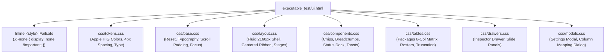
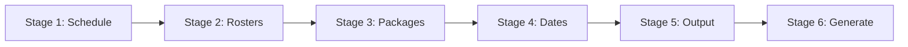

# UI Architecture

The frontend architecture of the **CvSU Document Generator** is built as a **Hybrid Guided Batch Workbench** utilizing vanilla web standards (HTML5, Vanilla CSS, Vanilla JavaScript ES6+) running inside Microsoft Edge WebView2. It combines Apple Human Interface Guidelines interaction ergonomics with native Windows desktop conventions, Segoe UI Variable typography, an offline 4px base spacing scale, and bounded WCAG 2.2 AA accessibility compliance.

Related notes:
- [[CvSU Document Generator MOC]]
- [[System Architecture]]
- [[PyWebView Bridge]]
- [[Testing Strategy]]
- [[HIG & UX Audit]]
- [[Documentation & Skills Audit]]
- [[User Manual]]
- [[v1.1.0]]

---

## 🚀 Document Transport Architecture (`file:///`)

The desktop runtime transport uses an explicit resolved file URI scheme:

```python
# executable_test/main.py
document_url = Path(html_template).resolve().as_uri()
window = webview.create_window(..., url=document_url)
```

### Forensic Root Cause & Motivation
Under earlier localhost HTTP implementations, PyWebView spun up an internal WSGI/Bottle server (`http://localhost:<random_port>/`). Forensic benchmarking revealed:
1. **Concurrency Pressure**: During cold desktop boot, WebView2 initiated concurrent GET requests for 20+ CSS/JS assets plus `ui.html`. The internal WSGI server (`request_queue_size = 5`) suffered connection queueing and latency spikes.
2. **Asset Starvation**: In failing launches, asset requests were stalled or dropped prior to HTTP response generation. When stylesheets were delayed, off-canvas side drawers and modals rendered exposed across the screen before CSS evaluation completed.
3. **Transport Immunity**: Migrating to `file:///` resolves all assets directly through the local Windows filesystem using the native OS file cache. It eliminates TCP socket binding, loopback port contention, and web server thread saturation. Parity benchmarks established 0/20 failures under `file:///` (versus 14/20 under cold localhost HTTP), with 100% parity across native bridge IPC and OLE Drag-and-Drop functionality.

---

## 🎨 Design System & Modular CSS Architecture

The application styling is structured into decoupled, modular CSS layers to eliminate specificity wars and prevent cascade failures:



### 1. Critical Visibility Inline Failsafe
To guard against any filesystem or engine delay, `executable_test/ui.html` embeds a synchronous inline stylesheet in its `<head>` before any external `<link>` tags:
```html
<style>
    .d-none { display: none !important; }
</style>
```
This guarantees that the browser engine applies hiding rules during initial layout passes before external stylesheets finish parsing.

### 2. Modular Stylesheet Inventory:
- **`css/tokens.css`**: Authoritative design tokens. Defines Apple HIG-derived semantic color palettes for Light and Dark themes, the **4px Base Spacing Scale** (`--space-1: 4px` through `--space-8: 32px`), Windows `Segoe UI Variable` system typography tokens, elevation box shadows, and transition curves.
- **`css/base.css`**: Base typography reset, fluid workspace bounds, global focus visible indicators (`:focus-visible` with 2px solid rings and 2px offset), and WCAG scroll clearance padding (`scroll-padding-top` and `scroll-padding-bottom: calc(var(--dock-height) + 16px)`).
- **`css/layout.css`**: Application workspace shell. Implements fluid desktop constraints (`width: min(96%, 2160px)`), centers the six-stage workflow navigation ribbon, and defines stage containers (`.workflow-stage`).
- **`css/components.css`**: Interactive components including stepper navigation chips, action buttons, section filter pills, breadcrumb trails, toast notification containers, and the compact status-only dock.
- **`css/tables.css`**: Data grid styling for the 8-column Packages class matrix, Schedule preview tables, and Roster tables. Handles column widths, cell padding based on the 4px scale, text truncation (`text-overflow: ellipsis`), and scroll boundaries.
- **`css/drawers.css`**: Dedicated slide-out drawer styles for the on-demand section Inspector (`#classInspectorDrawer`), Help drawer, and diagnostic Logs.
- **`css/modals.css`**: Modal dialog overlays for Settings, Roster Column Mapping, and workspace confirmation prompts.

---

## 🧭 Six-Stage Single-Active-Stage Navigation

The navigation flow is structured as a **six-stage contextual progression** governed by `executable_test/js/stepper.js`:



### Navigation Architecture & Stage Panel Identifiers:
- **Centered Workflow Ribbon (`#workflowRibbon`)**: Sticky horizontal navigation header centered within the main workspace. Displays six interactive stage chips (`#chipStep1` to `#chipStep6`).
- **Single-Active-Stage Model**: Exactly one workflow stage panel is rendered active (`.active-stage`) at any given moment. Inactive stage panels are hidden via `.d-none`, preventing vertical stacking and scroll exhaustion while keeping application state fully preserved in memory.
- **Stage Panels & Heading Hierarchy**:

| Stage Navigation | Actual Panel Heading | Panel Element ID | Heading Element ID | Navigation Chip ID |
| :--- | :--- | :--- | :--- | :--- |
| **Schedule** | Select Instructor Schedule (.xls or .xlsx) | `#cardStep1` | `#stageHeading1` | `#chipStep1` |
| **Rosters** | Select Student Rosters (.xlsx, .xls, or .csv) | `#cardStep2` | `#stageHeading2` | `#chipStep2` |
| **Packages** | Confirm Detected Classes & Subject Types | `#cardStep3` | `#stageHeading3` | `#chipStep3` |
| **Dates** | (Optional) Set Semester Date Boundaries | `#cardStep4` | `#stageHeading4` | `#chipStep4` |
| **Output** | Choose Target Output Folder | `#cardStep5` | `#stageHeading5` | `#chipStep5` |
| **Generate** | Initialize Workflow | `#cardStep6` | `#stageHeading6` | `#chipStep6` |

- **Bidirectional Non-Destructive Progression**: Users can revisit earlier stages (e.g. returning to Rosters to review a file or to Schedule to reload) without losing class selection, dates, or output directory settings.
- **Stage Completion Telemetry**: Each chip dynamically reflects completion status (`statusStep1` – `statusStep6`) using neutral ready dots, checkmarks, or amber warning indicators.

---

## 📦 Packages Stage: Batch Workbench & Global Selection Contract

Stage 3 (**Packages**) is the central batch workbench of the application (`#cardStep3`, headed by `#stageHeading3`):

### 1. The Eight-Column Class Matrix
The class table (`#packagesTable`) normalizes parsed faculty schedule entries into an 8-column responsive grid adhering strictly to the classes defined in `step2.js` and `ui.html`:
1. **Selection Checkbox (`col-select`)**: Master and per-row checkbox determining which classes are included in the generation batch.
2. **Section (`col-section`)**: Course and section identifier (e.g. `BSCS 3-1`).
3. **Subject Title (`col-subject`)**: Descriptive course name with graceful ellipsis.
4. **Schedule & Room (`col-schedule`)**: Meeting times, days, and assigned classroom.
5. **Classification (`col-classification`)**: Editable classification dropdown control (`<select class="type-dropdown class-type-select">`) supporting per-section configuration between "Lecture and Lab" (`lecture_lab`) and "Lecture only" (`lecture_only`). Not an informational badge.
6. **Enrolled (`col-students`)**: Matched student count derived from linked rosters.
7. **Status (`col-status`)**: Roster pairing readiness (`Roster Linked`, `Mismatch`, or `Unmatched`).
8. **Actions (`col-actions`)**: Opens the contextual slide-out Inspector for that specific class.

### 2. Global Batch-Level Document Package Selection
Document generation packages are configured globally at the top of the Packages workbench via batch checkboxes:
- **Attendance Sheets** (`#checkAttendance`)
- **CEIT Dept Forms** (`#checkCeit`)
- **Official Grade Sheets** (`#checkGrades`)

> [!IMPORTANT]
> **Architectural Invariant — Global Package Scope**:
> Package selection is strictly **global at the batch level**. Selected packages apply uniformly to all checked classes in the generation run. The backend PyWebView bridge contract (`engine_filter`) operates across the batch. The interface deliberately **does NOT provide per-section package overrides**.

### 3. Classification, Package Selection & Section Selection Semantics

The architecture clearly separates three distinct configuration layers:

1. **Global Document Package Selection**:
   - Packages: **Attendance Sheets** (`#checkAttendance`), **CEIT Dept Forms** (`#checkCeit`), **Official Grade Sheets** (`#checkGrades`).
   - Applied uniformly to all selected sections for the generation run.
   - **No per-section package override is supported**.

2. **Per-Section Classification**:
   - Values: **"Lecture and Lab"** (`lecture_lab`) and **"Lecture only"** (`lecture_only`).
   - Configured individually per section using the row dropdown control (`.class-type-select`).
   - Supports bulk updates via `applyBulkClassType()`, modifying all checked sections simultaneously.
   - Manual overrides are persisted in the frontend state mechanism using `localStorage` key `classTypeOverrides` via `saveClassTypeOverrides()` and restored on startup via `applyClassTypeOverrides()`.
   - **Generation Data Flow**:
     - *Normal generation path*: In `step3.js`, selected dropdown values are collected into the `typeOverrides` dictionary and passed as an argument to `window.pywebview.api.run_generation(typeOverrides, dateOverrides, selectedClasses, enabledEngines, state.rosterConfigs, exportPdf)`. The Python `GenerationAPI` receives this argument as `type_overrides` and forwards it to `process_all(...)`.
     - *Sample-preview path*: The document preview call passes an object payload to `window.pywebview.api.preview_sample_document(payload)` where the property is explicitly named `class_type_overrides`.
     - *Downstream orchestration effect*: The orchestrator utilizes the classification override to select the appropriate template roles:
       - **Lecture and Lab**: Selects `GRADING_LECTURE_LAB_TEMPLATE.xlsx` (containing Lecture, Laboratory, Consolidated, and Grading Sheet tabs) and integrated multi-session attendance templates.
       - **Lecture only**: Selects `GRADING_LECTURE_TEMPLATE.xlsx` (containing Lecture and Grading Sheet tabs) and standard lecture attendance templates.

3. **Section Selection**:
   - Checkboxes in matrix column `col-select` (using row selector `.item-class-check`) determine which detected sections are included in the generation run.
   - **Stage Navigation vs. Generation Preflight**: In Stage 3, clicking "Continue to Dates" invokes `activateStage(4)` and is not blocked by an empty selection, allowing free navigation across workflow stages.
   - **Generation Preflight Guard**: In Stage 6, **generation preflight requires at least one selected section**. If no sections are selected when `startGeneration()` executes (`selectedClasses.length === 0`), initializing the workflow is blocked with a "No Classes Selected" warning toast, and the user is returned to the Packages stage (`scrollToStep("cardStep3")`).

> [!CAUTION]
> **Do Not Conflate Classification with Package Selection**:
> Classification determines subject instruction type (Lecture and Lab vs. Lecture only) and is fully customizable per section with persistent overrides. In contrast, package selection determines which document types are built (Attendance Sheets, CEIT Dept Forms, Official Grade Sheets) and is strictly batch-global.

### 4. Contextual Section Inspector Drawer (`#classInspectorDrawer`)
Clicking "Inspect" on any class matrix row slides open the Inspector drawer from the right edge:
- Displays detailed section metadata, schedule hours, and room assignment.
- Visualizes linked roster status and enrolled student counts.
- Provides immediate access to verify or remap roster columns.
- Preserves user focus without leaving the Packages stage and without altering global package selections.

---

## ⚓ Status-Only Persistent Dock (`#bottomActionBar`)

In Phase 6.1 and Phase 7, the floating bottom action bar was refactored into a **compact, scroll-aware status-only dock**:
- **Removal of Competing Primary Actions**: The persistent dock does **NOT** house a primary "Initialize Workflow" or "Generate" button. Competing primary buttons have been eliminated.
- **Active Workspace Primary Action**: The primary action button for each stage resides directly inside that stage's workspace (e.g. "Continue to Rosters" in Stage 1, "Continue to Packages" in Stage 2, "Initialize Workflow" in Stage 6).
- **Readiness Telemetry Chips**: The dock displays real-time readiness indicators:
  - Schedule loaded status
  - Rosters matched status
  - Selected packages count
  - Output folder configured status
- **Scroll Clearance**: `base.css` defines `scroll-padding-bottom: calc(var(--dock-height) + 16px)` on scrollable containers, ensuring that bottom-row table content and buttons are never occluded by the dock.

---

## ⚡ JavaScript Initialization Lifecycle (`js/app.js`)

To ensure deterministic initialization across WebView2 engine versions and desktop environments, application bootstrapping is managed by `bootstrapApp()`:

```javascript
function bootstrapApp() {
    if (window.__app_initialized__) return;
    window.__app_initialized__ = true;
    window.__app_bootstrap_runs = (window.__app_bootstrap_runs || 0) + 1;

    initTheme();
    initStepper();
    initBridge();
    initDrawers();
    initModals();
    initSettings();
    initSteps();
}

if (document.readyState === 'loading') {
    document.addEventListener('DOMContentLoaded', bootstrapApp);
} else {
    bootstrapApp();
}
```

### Observability Sentinels:
- `window.__app_initialized__`: Boolean sentinel asserting successful initialization.
- `window.__app_bootstrap_runs`: Counter confirming that bootstrap executed exactly once without double-binding event listeners.

---

## 🖱️ Native Drag-and-Drop (DnD)

To provide a seamless desktop experience, the UI relies on a hybrid drag-and-drop system:
- **Frontend Dropzones**: Defined in HTML with `js/bridge.js` intercepting standard DOM `dragenter`/`dragleave`/`drop` events.
- **Native OLE Intercept (`executable_test/native/dnd.py`)**: Windows Edge WebView2 sandboxes direct file drops. The Python backend overrides the Windows window procedure to act as a native OLE `IDropTarget`.
- **Payload Routing**: When files are dropped, the native layer routes them through `bridge.js` directly to the `ScheduleAPI` or `RosterAPI` mixins to be ingested identically to native file-dialog selections.

---

## 🗔 Dialogs, Modals & Settings Architecture

Configuration and auxiliary user flows are handled out-of-band to prevent interrupting the main workflow:
- **Settings Modal (`js/settings.js`)**: Uniform desktop dialog box (`width: min(920px, calc(100vw - 32px))`) adhering to Apple HIG Inset Grouped List patterns with themed squircle icon tiles and real-time Document Header Live Preview.
- **Roster Column Mapping Modal (`#modalColumnMappingBackdrop`)**: Interactive dialog allowing users to map arbitrary or malformed spreadsheet headers to canonical roster fields (`student_number`, `student_name`, `gender`).
- **Focus Management**: Modals implement active focus trapping (`Tab`/`Shift+Tab` cycling) and `Escape` key listeners, returning focus to the trigger button upon dismissal.

---

## 🔔 Toast Notification Engine (`js/toast.js`)

Non-modal notification system replacing blocking dialog alerts:
- Host Element: `<div id="toastContainer" class="toast-container" role="region" aria-label="System notifications"></div>`
- Variants: `success`, `error`, `info`.
- Accessibility: Accessible live regions (`role="status"`, `aria-live="polite"`).

---

## 🌓 View Transition Theming Architecture (`js/theme.js`)

The dark/light theme toggle uses the **CSS View Transitions API** (Chromium) to produce a circular iris reveal originating from the toggle button coordinates:

```text
document.startViewTransition(() => { applyTheme(); })
        ↓
transition.ready  ← Pseudo-elements exist only after this resolves
        ↓
document.documentElement.animate(
    { clipPath: [ "circle(0px at x y)", "circle(endRadius at x y)" ] },
    { duration: 450, easing: "cubic-bezier(0.25, 1, 0.5, 1)",
      fill: "both", pseudoElement: "::view-transition-new(root)" }
)
        ↓
await transition.finished
```

- **Separation of Responsibilities**: WAAPI is the sole owner of circular geometry (`THEME_TRANSITION_DURATION_MS = 450ms`); CSS owns static edge styling (`--vt-edge-specular`).
- **Reduced Motion Awareness**: When `prefers-reduced-motion: reduce` is detected (from Windows Settings or app preferences), spatial transitions and iris animations are bypassed in JavaScript before starting the transition.

---

## ♿ Accessibility Compliance & Assessment Boundaries

The UI implements accessibility features informed by Apple HIG and WCAG 2.2 AA standards:
- **WCAG 2.2 SC 2.4.11 Focus Not Obscured (Minimum) (Level AA)**: Enforced via `scroll-padding-bottom: calc(var(--dock-height) + 16px)` on scrollable areas, ensuring focused inputs and table buttons are never occluded by the sticky status dock.
- **WCAG 2.2 SC 2.4.12 Focus Not Obscured (Enhanced) (Level AAA)**: Evaluated separately. While most controls achieve complete non-obscuration, full Level AAA compliance across all desktop zoom levels is an aspirational standard.
- **WCAG 2.2 SC 2.5.7 Dragging Movements (Level AA)**: File dropzones provide equivalent single-pointer click-to-browse alternative actions.
- **WCAG 2.2 SC 2.5.8 Target Size (Minimum) (Level AA)**: Interactive buttons and table controls meet the 24×24px minimum bounding box or qualify under inline/essential exceptions.
- **Visible Focus Rings (SC 2.4.7)**: Explicit 2px high-contrast focus rings with 2px offset on all interactive controls.
- **Boundary Notice**: Automated Playwright accessibility scans (Axe-core) and screenshot reviews provide bounded evidence of accessibility quality. They do not constitute a formal third-party WCAG certification.

---

## 🔍 Pre-Flight Sample Document Preview (`#modalPreflightPreviewBackdrop`)

Provides an in-memory document synthesis preview before launching a complete batch:
- **Dynamic Font Scaling Badge**: Real-time tier resolution based on student count (8pt Tier for $\le 30$ students; 7pt Tier for $31-35$; 6pt Tier for $> 35$).
- **Resolved Semantic Slots Table**: Previews resolved instructor, course code, room, and semester strings.
- **Sample Roster Table**: Displays first 10 parsed student records.
- **Signatory Hierarchy**: Displays resolved multi-tier approval chain.

---

## ⏱️ Batch Generation Telemetry & Cooperative Cancellation

Stage 6 (**Generate**) handles the batch execution lifecycle:
- **Stage vs. Button Labeling**: The navigation context is named **Generate**. The primary process button within the Stage 6 panel (`#cardStep6`) is `#processBtn` (housing `#processBtnLabel`), with the visible button label **Initialize Workflow**.
- **Preflight Blockers**: If required inputs (Schedule, Rosters, at least 1 Section, at least 1 Package, or Output Directory) are missing, preflight displays actionable warning banners with direct navigation buttons to jump to the incomplete stage.
- **Progress Telemetry (`#progressContainer`)**: ARIA progressbar compliance (`role="progressbar"`, live `aria-valuenow`, `aria-live="polite"`). Dual-channel telemetry combines PyWebView event callbacks with 350ms cooperative polling.
- **Cooperative Cancellation (`#btnCancelGeneration`)**: Mid-batch cancellation checked between document generation tasks. Cancelling halts future generations safely while **preserving all completed output files on disk**.
