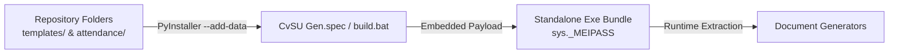

# Template Guidelines

This note details architectural standards, packaging requirements, and auto-scaling rules for templates used across the application.

Related notes:
- [[CvSU Document Generator MOC]]
- [[CEIT Templates]]
- [[Attendance Templates]]
- [[Grading Templates]]
- [[Generators Overview]]

---

## 🏛️ Template Storage & Packaging



1. **Repository Layout**:
   - Academic forms (`.docx`) and Grade Sheets (`.xlsx`): Placed in `templates/`.
   - Attendance templates (`.docx`): Placed in `attendance/`.
2. **Bundling Rules**:
   - `build.bat` and `CvSU Gen.spec` embed both directories using:
     ```text
     --add-data "..\templates;templates/"
     --add-data "..\attendance;attendance/"
     ```
3. **Template Immutability**:
   - Master templates must never be modified in-place or overwritten during execution.
   - All document generation reads master templates into memory and saves to new files in the user's selected output destination.
4. **Custom User Templates**:
   - Registered at runtime by the user via the `TemplateMixin` API.
   - Files and recipes are physically persisted in `%APPDATA%/CVSU_Generators/custom_templates/`.
   - Not bundled in the executable; they persist locally per-user and are resolved dynamically at runtime.

---

## 🏷️ Semantic Slot Anchoring & Grid Normalization

Modern templates—both official and custom—are processed without hardcoded row/column coordinates by leveraging deterministic structural anchors:

### 1. Semantic Slot Anchoring Strategies
`DeterministicTemplateAnalyzer` (`modules/parsers/template_analyzer.py`) scans template geometry to discover metadata slots via four anchoring modes:
- **`cell_right`**: The value cell is directly adjacent to the label cell on the horizontal visual axis. If a colon separator cell exists (e.g. `[Label] [:] [Value]`), the normalizer transparently navigates across the separator to the target value cell via `target_value_cell_right`.
- **`cell_below`**: The value cell is directly below the label cell on the vertical visual axis (common in multi-column institutional headers).
- **`colon_value`**: The label and value are within the same paragraph separated by a colon (`:`), populated without disturbing leading runs or formatting.
- **`placeholder`**: Explicit template tags (e.g. `{{INSTRUCTOR}}`, `{{COURSE_SECTION}}`, `{{SUBJECT}}`), resolved across single runs or merged across split `<w:r>` XML elements.

### 2. Merged-Grid Normalization (`DocxGridTable`)
In complex Word tables, merged cells (`<w:gridSpan>` and `<w:vMerge>`) distort the visual structure, causing physical `<w:tc>` counts to vary per row.
- `DocxGridTable` (`modules/parsers/docx_grid_table.py`) constructs a complete 2D rectangular matrix representing the true visual layout.
- Every coordinate `(row, col)` resolves to the canonical top-left `<w:tc>` origin cell (`get_canonical_cell`).
- Cell mutations are tracked in a mutation registry to prevent duplicate text injection on continuation cells.

### 3. Template Blueprint & In-App Diagnostics (`TemplateManifest`)
When a template is uploaded, `DeterministicTemplateAnalyzer` emits a structured `TemplateManifest`:
- **`is_ready`**: Boolean readiness property checking if metadata slots and repeating tables were located.
- **`get_diagnostics()`**: Returns clear diagnostic notices detailing:
  - Detected metadata slots (e.g. `Instructor`, `Course & Section`, `Schedule Code`).
  - Student roster or attendance matrix table topologies, first data row, and row capacity.
  - Actionable feedback on missing fields or unmapped tags so users know if template adjustments are needed.

---

## 📏 Auto-Scaling & Formatting Safeguards

### Dynamic Student Name Font Scaling Ladder
Filipino names and long surnames frequently exceed standard column widths. Rather than a single crude cutoff, the engine applies an institutional multi-tier font reduction ladder in `modules.common.docx_utils:get_student_name_font_sz` and `DynamicDocumentRenderer`:
- **$\le 30$ characters**: **8pt** (`sz="16"`, template default)
- **$31–35$ characters**: **7pt** (`sz="14"`)
- **$> 35$ characters**: **6pt** (`sz="12"`)

For custom user templates where the author selected a larger base font (e.g. 11pt), font auto-scaling preserves the custom style until length exceeds 32 characters, scaling down to 9pt (`sz="18"`).

### Table Row Cloning & List Auto-Numbering Preservation
When generating student rosters, `DynamicDocumentRenderer` isolates a prototype data row:
- **XML Run Clearing**: Clears existing `<w:t>` text nodes while strictly preserving cell formatting, borders, paragraph properties (`<w:pPr>`), and run properties (`<w:rPr>`).
- **Native `<w:numPr>` Preservation**: If the template uses Microsoft Word native list auto-numbering in the index column, the generator retains the `<w:numPr>` element without injecting literal numeric text (`1`, `2`, `3`), preventing double numbering artifacts.
- **Capacity Row Handling**: When roster size is less than template capacity, excess rows are cleanly cleared or removed without breaking table height or border symmetry.

