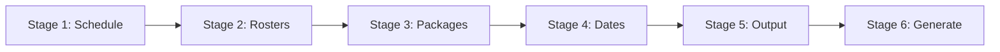

# User Manual

A comprehensive faculty guide for generating academic documents using the **CvSU Document Generator** desktop application.

Related notes:
- [[CvSU Document Generator MOC]]
- [[Input File Conventions]]
- [[Troubleshooting]]
- [[UI Architecture]]
- [[v1.1.0]]

---

## 💻 System Requirements

- **Operating System**: Windows 10 or Windows 11 (64-bit).
- **Python Runtime**: None required on the user workstation. The Python engine and all required libraries are bundled inside `CvSU Gen.exe`.
- **Microsoft Edge WebView2 Evergreen Runtime**: Standard Windows component (built into Windows 11 and up-to-date Windows 10 installations).
- **Office Software**: Microsoft Word & Excel (or compatible office suites) to view or print the generated `.docx` and `.xlsx` files. The generator produces files natively without requiring Office to be open.

---

## 🧭 The Six-Stage Workflow Overview

The application organizes document generation into **six contextual stages**. You can navigate back and forth between stages using the top workflow ribbon without losing your progress:

### Stage Hierarchy & Panel Headings:

| Stage Navigation | Actual Panel Heading | Panel Element ID | Heading Element ID | Navigation Chip ID |
| :--- | :--- | :--- | :--- | :--- |
| **Schedule** | Select Instructor Schedule (.xls or .xlsx) | `#cardStep1` | `#stageHeading1` | `#chipStep1` |
| **Rosters** | Select Student Rosters (.xlsx, .xls, or .csv) | `#cardStep2` | `#stageHeading2` | `#chipStep2` |
| **Packages** | Confirm Detected Classes & Subject Types | `#cardStep3` | `#stageHeading3` | `#chipStep3` |
| **Dates** | (Optional) Set Semester Date Boundaries | `#cardStep4` | `#stageHeading4` | `#chipStep4` |
| **Output** | Choose Target Output Folder | `#cardStep5` | `#stageHeading5` | `#chipStep5` |
| **Generate** | Initialize Workflow | `#cardStep6` | `#stageHeading6` | `#chipStep6` |

---

## 📋 Step-by-Step Walkthrough

### Stage 1: Schedule — "Select Instructor Schedule (.xls or .xlsx)"
In this initial stage, you load your official faculty teaching schedule:
1. **Choose File**: Click **"Browse Schedule"** or drag and drop your schedule file (`.xls` or `.xlsx`) directly onto the designated dropzone.
2. **Review Extracted Details**: The application automatically extracts your instructor name, college/campus header, semester, academic year, and scheduled class blocks.
3. **Continue**: Once your schedule is loaded, click **"Continue to Rosters"** in the stage action panel.

---

### Stage 2: Rosters — "Select Student Rosters (.xlsx, .xls, or .csv)"
In this stage, you provide the student enrollment rosters for your classes:
1. **Add Rosters**: Click **"Browse Rosters"** or drag and drop your downloaded roster spreadsheets (`.xlsx` or `.csv`). You can drop multiple files or entire folders simultaneously.
2. **Automatic Portal Cleaning & Matching**: The system automatically strips unnecessary portal columns, detects student numbers, names, and gender, and matches each roster to your scheduled classes based on schedule codes or course identifiers.
3. **Resolving Mismatches / Repair**: If any roster has custom column headers or an unrecognized filename:
   - Use the roster table's dropdown to manually link the roster to the correct section.
   - Click **"Map Columns"** to open the column mapper dialog if the spreadsheet uses non-standard header names.
4. **Continue**: When your rosters are verified, click **"Continue to Packages"**.

---

### Stage 3: Packages — "Confirm Detected Classes & Subject Types"
Stage 3 is the full-width batch workbench where you define document packages, verify detected classes, and configure subject classifications:

#### 1. Global Document Package Selection
At the top of the workbench, select the document packages you wish to produce for this run:
- **☑ Attendance Sheets** (`#checkAttendance`): Monthly attendance tracking sheets with calendar grids.
- **☑ CEIT Dept Forms** (`#checkCeit`): Syllabus receipts, class records, and departmental forms.
- **☑ Official Grade Sheets** (`#checkGrades`): Official Excel grade calculation workbooks.

> [!IMPORTANT]
> **Global Selection Scope (No Per-Section Package Overrides)**:
> Selected document packages apply **uniformly to all checked sections** in the generation batch. The application does not support applying different package combinations to different sections in a single run.

#### 2. Class Matrix, Per-Section Classification & Bulk Controls
Review and configure your classes in the 8-column class matrix:
- **Selection Checkboxes (`col-select`)**: Check the box for each section you wish to generate (row selector `.item-class-check`). While clicking "Continue to Dates" (`activateStage(4)`) freely transitions to Stage 4 without blocking navigation, **generation preflight requires at least one selected section**. If no sections are selected when initializing the workflow in Stage 6 (`selectedClasses.length === 0`), generation is blocked with a "No Classes Selected" warning toast, and you are automatically returned to the Packages stage (`cardStep3`).
- **Per-Section Classification (`col-classification`)**: Each class row features an editable dropdown control (`.class-type-select`) with two options:
  - **"Lecture and Lab"** (`lecture_lab`): Selects the integrated lecture and laboratory grading template (`GRADING_LECTURE_LAB_TEMPLATE.xlsx` with Lecture, Laboratory, Consolidated, and Grading Sheet tabs) and multi-session attendance templates.
  - **"Lecture only"** (`lecture_only`): Selects the standard lecture grading template (`GRADING_LECTURE_TEMPLATE.xlsx` with Lecture and Grading Sheet tabs) and lecture attendance templates.
- **Bulk Classification Updates**: You can check multiple sections and use the bulk classification action (`applyBulkClassType`) to toggle all checked classes to "Lecture and Lab" or "Lecture only" in a single action.
- **Persistent Overrides**: Any manual classification change is automatically preserved in local storage under key `classTypeOverrides` (`saveClassTypeOverrides`) and restored on launch (`applyClassTypeOverrides`). During generation, these overrides are collected into `typeOverrides` and transmitted directly to the generation engine (`run_generation`).
- **Contextual Inspector (`col-actions`)**: Click the **"Inspect"** button on any class row to open the side drawer, where you can verify enrolled student counts and roster matching details.

> [!NOTE]
> **Do Not Conflate Classification with Package Selection**:
> Classification defines the pedagogical structure of each course (Lecture and Lab vs. Lecture only) and is configurable per-section with persistent overrides. In contrast, package selection determines which document families are generated (Attendance Sheets, CEIT Dept Forms, Official Grade Sheets) and is applied globally to the entire batch.

3. **Continue**: When your packages, sections, and classifications are configured, click **"Continue to Dates"**.

---

### Stage 4: Dates — "(Optional) Set Semester Date Boundaries"
In this stage, you configure the calendar parameters for attendance tracking:
1. **Optional Boundaries**: Enter a **Start Date** and **End Date** if you want attendance sheets to cover a specific date range.
2. **Standard Semester Defaults**: Leaving the dates blank is completely valid—the generator will automatically apply standard academic calendar boundaries for your semester.
3. **Presets & Reset**: Use preset buttons for quick semester setups or click **"Reset Dates"** to restore default boundaries.
4. **Continue**: Click **"Continue to Output"**.

---

### Stage 5: Output — "Choose Target Output Folder"
In this stage, you select where generated documents will be saved on your computer:
1. **Choose Folder**: Click **"Select Output Directory"** to open the native Windows folder picker.
2. **Organized Structure**: Generated files are automatically organized into clean subfolders by course and section (e.g. `BSCS 3-1/CEIT_Forms/`, `BSCS 3-1/Attendance/`, etc.).
3. **Continue**: Click **"Continue to Generate"**.

---

### Stage 6: Generate — "Initialize Workflow"
The final stage performs safety preflight checks before creating files:
1. **Preflight Summary**: The panel reviews your configuration:
   - Schedule loaded
   - Rosters matched
   - Sections selected (must be $\ge 1$)
   - Document packages selected (must be $\ge 1$)
   - Output folder set
2. **Blocker Alerts**: If any prerequisite is missing, a prominent alert identifies the issue with a direct link to return to that stage and fix it.
3. **Starting Generation**: Click the primary button labeled **"Initialize Workflow"** (`#processBtn`) to begin generation.
4. **Real-Time Progress**: A determinate progress bar tracks document creation in real time.
5. **Safe Cancellation**: You may click **"Cancel Generation"** at any time. Cancellation halts processing safely between documents without corrupting or deleting files already created on your disk.
6. **Completion**: When finished, click **"Open Output Folder"** to view your generated documents in Windows Explorer.

---

## ⚓ Status Dock

A compact status bar at the bottom of the screen displays real-time readiness indicators for your schedule, rosters, packages, and output folder across all stages. Primary actions (such as "Continue" or "Initialize Workflow") remain clearly located within the active stage workspace itself.
